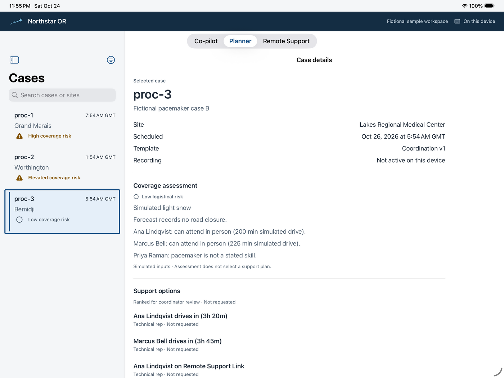
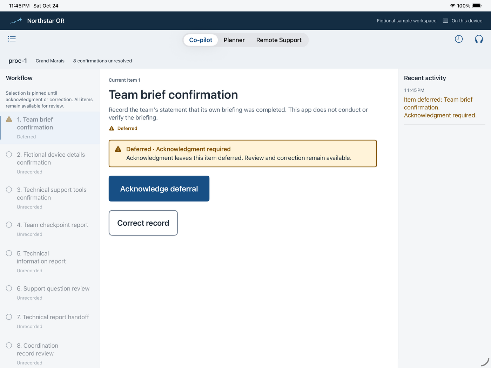
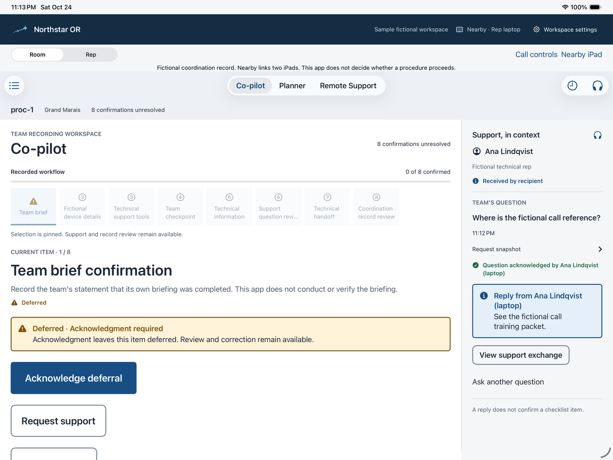
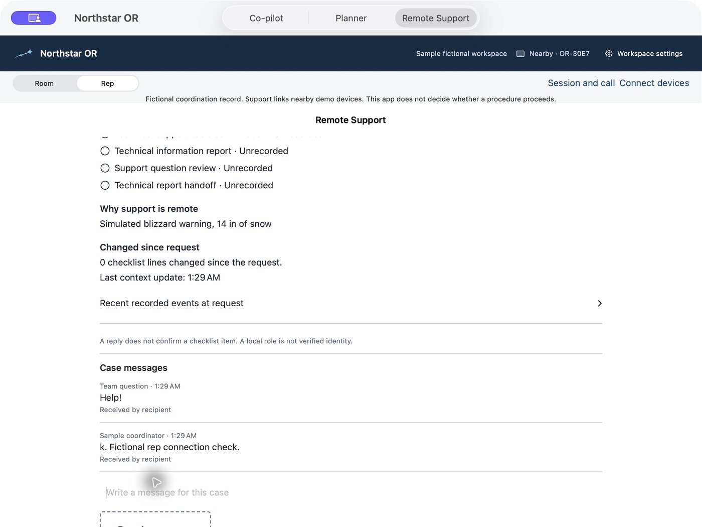
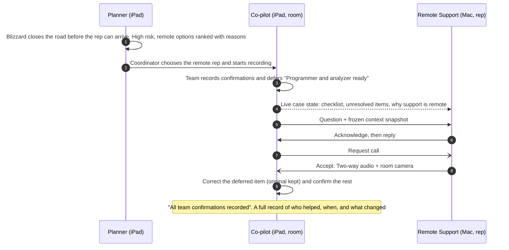
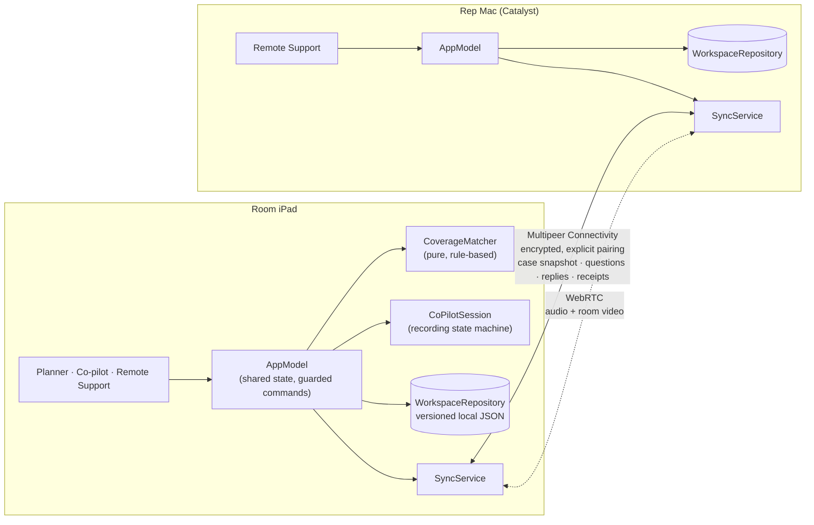
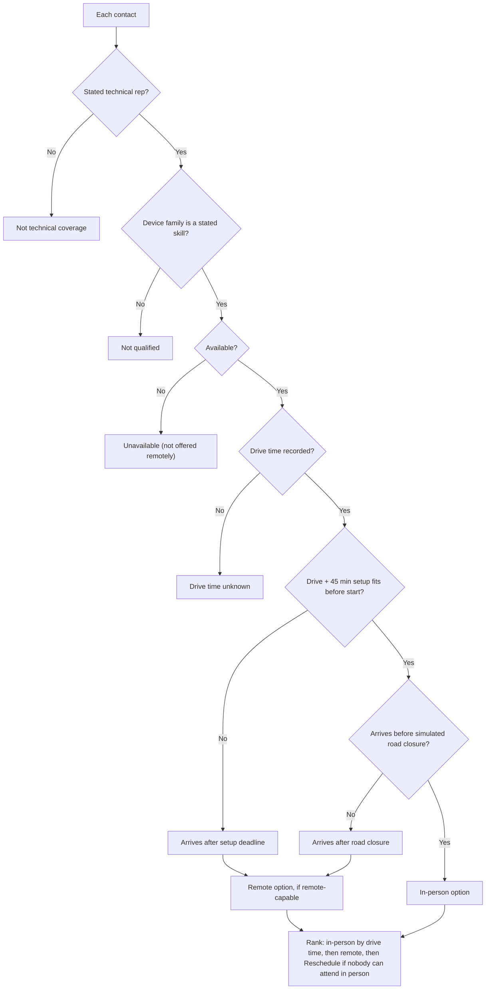

<p align="center"></p>

<p align="center"><b>The storm cuts the road. It shouldn't cut the support.</b></p>

# Northstar OR

**A coordination app for rural operating rooms when the device rep can't get there.** Native iPad app for the room team, plus a native Mac app for the remote device representative. Built in 24 hours for the Medtronic × UMN Social Coding Club hackathon. The prompt was *Connect & Intersect*.

> **Simulated data only.** Every hospital, person and case is fictional. Northstar is a hackathon demonstration, not a medical device. It records what the team reports and shares context; it never makes clinical decisions, programs a device or judges whether a procedure should proceed.

## The problem

Pacemaker and ICD procedures normally have a manufacturer's device representative in the room to run the programmer and help with the device. Heart Rhythm Society policy limits reps to technical support under a physician's direction, and names *distance from the facility* as a reason remote support is allowed.

In rural Minnesota that distance is real, and a blizzard can close the road. When the rep can't come, today's fallback is a phone or video call. The rep starts with no context: which case, which device, what the team has already confirmed and what's still open. In emergency-department studies, device checks that depended on a rep or programmer took a median of **2.5–3.5 hours** ([REMEDY](https://clinicaltrials.gov/study/NCT01871090), [CEEM 2016](https://doaj.org/article/938332f9eb5840ba82ca0e853343f78e)). About **45%** of device patients arrive without their device ID card ([EP Monthly](https://epmonthly.com/article/remote-cied-interrogator-usage-in-the-emergency-department/)).

Manufacturer remote-support tools share video and the programmer screen. None of the ones we found share the *case state*: what's confirmed, what's deferred and what the question is about. Northstar fills that gap.

## What it does

Northstar has three tabs: **Planner** (before the case), **Co-pilot** (during the case) and **Remote Support** (for the rep).

| | Planner | Co-pilot | Remote Support |
|---|---|---|---|
| **Who** | Coordinator | Room team (iPad) | Device rep (Mac) |
| **What it does** | Checks who can actually reach the case: stated skills, availability, drive time and setup buffer versus a simulated road closure. Ranks in-person, remote and reschedule options **with plain-language reasons**. It never picks for you. | Records what the team reports at each step of a fictional pacemaker coordination checklist. A deferred required step stays pinned behind an amber warning until it's acknowledged or corrected. Every correction keeps the original. | The rep joins late and immediately sees the case, the checklist and what's still open. Questions carry a frozen snapshot of the context. The rep acknowledges and replies. Either side can start a two-way audio call with room-camera video. |

### Screenshots

These are real simulator captures from the app's UI tests, taken during development. They show the earlier sample data (`proc-1`, the version 1 checklist). The demo workspace uses GM-1025 and the pacemaker milestones described in [the demo runbook](docs/DEMO_WORKSPACE.md).

<table>
<tr>
<td width="50%"><br><b>Planner.</b> Coverage risk per case, the reasons behind it and ranked support options, marked "Not requested" until someone chooses.</td>
<td width="50%"><br><b>Co-pilot.</b> A required item was deferred. It stays pinned with a persistent warning, and acknowledgment and correction remain available.</td>
</tr>
<tr>
<td><br><b>Support in context, on the room iPad.</b> The team's question, the rep's acknowledgment and reply, next to the still-pinned deferral.</td>
<td><br><b>The rep's Mac.</b> The open checklist, why support is remote, what changed since the request and the case messages, all without being told.</td>
</tr>
</table>

## How it works

### The journey



### Architecture

One SwiftUI codebase runs as the **room app on iPad** and the **rep app on Mac** (Mac Catalyst). Each device keeps its own records. The two connect directly over the local network, with no server.



- **Features never talk to the network directly.** Everything goes through `SyncService`, so the transport can be swapped. Today it's nearby Wi-Fi; an internet relay is the next step.
- **Save first, then send.** A message is saved before it's sent and retried after reconnecting. "Saved", "received" and "acknowledged" are shown as separate states.
- **The room is the only recording authority.** The rep can read, ask, acknowledge and reply, but can't change the checklist.

### Coverage Matcher rules



Risk is **low** (someone can attend), **elevated** (roads close during the case window) or **high** (nobody can attend in person). Each contact gets a sentence explaining its result. No AI and no black-box score.

## The demo scenario

**Arrowhead Cardiac Coverage (fictional).** Case **GM-1025** is a pacemaker case in Grand Marais on the North Shore. A simulated blizzard drops 14 inches of snow and closes the shoreline highway in 90 minutes. Ana Lindqvist, the rep in Duluth, is 110 minutes away and can't make it, so the team gets her remotely.

- [`docs/DEMO_SCRIPT.md`](docs/DEMO_SCRIPT.md): the five-minute script, setup and fallbacks.
- [`docs/DEMO_WORKSPACE.md`](docs/DEMO_WORKSPACE.md): every site, case, contact and weather value, and why it's realistic.
- [`reports/Rural device rep coverage gaps.md`](reports/Rural%20device%20rep%20coverage%20gaps.md): the sourced research behind the problem, plus the claims we deliberately don't make.

## What works and what doesn't

| Area | In the build | Not in the build |
|---|---|---|
| Workspace and cases | Blank or sample setup, editable sites and contacts, new and edit case, explicit start and resume, local persistence across relaunch | Multi-user accounts, verified identity |
| Planner | Rule-based coverage risk, reasons and ranked options; versioned coverage-request contracts | Request and accept buttons in Planner; map; live weather or road data (weather is fictional, hourly scenario data) |
| Co-pilot | Explicit confirm, defer, acknowledge and correct; pinned warnings; unresolved-first history; bounded voice commands (optional, touch remains the fallback) | Ending or reopening a recording; camera observation |
| Remote Support | Paired iPad↔Mac case brief, live progress, snapshot questions, acknowledgment, replies, retained messages | Internet or distant transport; push notifications when the app is closed |
| Calls | Invitation and acceptance, two-way audio, room-camera video, mute and end | Physical checks of every control are still pending; see [`docs/NATIVE_DEMO_STATUS.md`](docs/NATIVE_DEMO_STATUS.md) |
| AI | None | No AI or image interpretation. Video is shared, not analyzed |

## Run it

Requirements: Xcode 15+, iPadOS 17+, [XcodeGen](https://github.com/yonaskolb/XcodeGen).

```sh
brew install xcodegen
xcodegen generate          # creates NorthstarOR.xcodeproj from project.yml
open NorthstarOR.xcodeproj
```

1. Choose your own team under *Signing & Capabilities*.
2. Run on an **iPad** (landscape). This is the room.
3. Run on **My Mac (Mac Catalyst)**. This is the rep; it defaults to the Rep role.
4. On both: **Load sample workspace**, then **Connect devices → Find Northstar devices**, and accept the pairing. Both devices need the same Wi-Fi and Local Network access.

The `.xcodeproj` is generated and git-ignored. Run `xcodegen generate` again after pulling changes that add files.

**Tests:** `bash scripts/check-repo.sh` and `bash scripts/check.sh`. GitHub Actions runs the repository checks plus the iPad build and unit/UI tests on every PR.

## Project layout

```
NorthstarOR/
  App/              entry point, AppModel (shared state + commands), RootView
  DesignSystem/     Northstar theme tokens, components, workspace chrome
  Models/           workspace, case, session, support-exchange, coverage-plan, planning-evidence contracts
  Data/             fictional sample workspace, coordination template, hourly weather scenarios
  Services/         WorkspaceRepository (storage), SyncService, Multipeer transport, WebRTC calls, voice
  Features/
    Workspace/      setup, settings, contacts
    Planner/        CoverageMatcher, case list and detail, case form
    CoPilot/        CoPilotSession state machine, recording UI, support panel, call view, voice
    RemoteSupport/  rep brief, questions and replies, pairing
NorthstarORTests/   unit and integration tests (matcher, session, storage, support exchange, voice, sample data)
NorthstarORUITests/ simulator journeys with screenshot evidence
docs/               product, design, demo script and runbook, status, evidence
```

## Further reading

| Doc | What's in it |
|---|---|
| [PRODUCT.md](docs/PRODUCT.md) | Product scope and boundaries |
| [DESIGN.md](docs/DESIGN.md) | UI/UX rules, screen contracts, accessibility |
| [NATIVE_DEMO_STATUS.md](docs/NATIVE_DEMO_STATUS.md) | Feature audit: what's implemented, verified and pending |
| [OR_LANDSCAPE.md](docs/OR_LANDSCAPE.md) | How an OR case runs; existing tools |
| [TASKS.md](docs/TASKS.md) | Task board and ownership |
| [TEAM_WORKFLOW.md](docs/TEAM_WORKFLOW.md) | Branches, PRs and checks |
| [brand/](docs/brand/README.md) | Logo, app icon and usage |

## Team

- Rahil Sheth ([@rsheth8](https://github.com/rsheth8))
- Amartya Setty

## Tools, libraries, and AI credits

Required by the hackathon rules. Keep this list up to date.

- Python 3 standard-library tooling selects the CI iPad baseline and tests mixed-runtime selection; no app dependency.

- Swift, SwiftUI, Observation, AVFoundation (text-to-speech), Speech (on-device recognition), MapKit
- Apple SwiftUI AnyLayout keeps one set of recording and device controls across horizontal and vertical arrangements; scrollDismissesKeyboard keeps setup fields reachable while scrolling.
- Apple Multipeer Connectivity for encrypted, explicitly paired native iPad/Mac session snapshots, support envelopes and WebRTC signaling; Apple Mac Catalyst runs the shared SwiftUI app on Mac. Physical-device proof remains separately recorded in docs/evidence/nearby-support/.
- [WebRTC](https://webrtc.googlesource.com/src), BSD-3-Clause, via [stasel/WebRTC](https://github.com/stasel/WebRTC) 155.0.0. Supplies call audio processing, Opus and video codecs. Connection flow inspired by [stasel/WebRTC-iOS](https://github.com/stasel/WebRTC-iOS), Apache-2.0. The native iPad/Mac call uses the same framework through Mac Catalyst. Browser RTCPeerConnection and Node.js built-in HTTP/crypto remain an experimental harness; no paid call provider.
- Apple Foundation URLSessionWebSocketTask, browser WebSocket and sessionStorage power the separate same-Wi-Fi shared-session feed and retained laptop support exchange; no new provider or dependency.
- XcodeGen for project generation
- GitHub Actions with `actions/checkout` and `actions/upload-artifact` for CI; Dependabot for action updates
- Inter Display (SIL Open Font License) for the logo wordmark
- Blender (GPL) and Google Chrome (headless) produced the earlier 3D emblem, preserved in `docs/brand/archive/rural-emblem-v1/`.
- Institutional shooting-star identity: OpenAI Codex created the connected star/pulse SVG artwork, neutral wordmark composition, and export tooling, informed by the team's direction and earlier OpenAI image-generation exploration. Rural scenes are preserved as presentation illustrations in `docs/brand/archive/`. AppKit/Swift and Pillow export the production PNGs; these are build tools only, with no new app dependency.
- AI assistance: Claude (Anthropic) helped with brainstorming, the pitch proposal, the brand and logo, and the starter code scaffold. All code was written during the event.
- AI assistance: OpenAI Codex helped review the starter and document the product direction/status, UI/UX rules, configurable product foundation, institutional interface reference study, implementation blueprint, partner/subagent execution plan, five-minute presentation plan, and task roadmap. No vendor screenshots/assets, AI runtime or camera library were added by this documentation update.
- AI assistance: Claude Code (Anthropic) helped research rural device-rep coverage, build the fictional demo data and checklist wording, write the demo script, and write this README with diagrams. README screenshots are the app's own simulator captures from `docs/evidence/`, resized and rotated.
