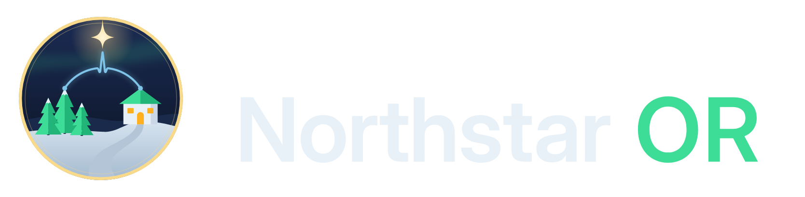

<p align="center"></p>

# Northstar OR

**A storm-aware surgical co-pilot for rural Minnesota hospitals.** Built in 24 hours for the Medtronic × UMN Social Coding Club hackathon, prompt: *Connect & Intersect*.

When a blizzard prevents an expert from reaching a small-town hospital, Northstar OR helps the team arrange support, track reported workflow progress, and share context. Device representatives provide technical device support; clinical specialists have distinct roles and responsibilities.

- **Planner + Coverage Matcher.** Surfaces coverage risk and ranks logistical options for human review. The planned coordinator flow commits to one named-rep request or marks the case to reschedule, keeps backups visible, and distinguishes availability from acceptance.
- **iPad Co-pilot.** Tracks team-reported checklist progress, surfaces unresolved confirmations, and records timestamped events. Voice controls and focused camera observations are planned extensions. It prompts and documents; it never makes clinical decisions.
- **Remote Support Link.** Prepares context so a human expert can join with the team's question, current workflow, and unresolved items. Teams should be able to request help at any time; a deviation is not a prerequisite.

> All data is simulated. Northstar OR is a hackathon demonstration and is not validated or intended for clinical use. It does not verify surgical correctness or determine whether a procedure should proceed.

## Start here with your partner

Read [the product brief](docs/PRODUCT.md) for the agreed experience, boundaries, camera/AI scope, and demo. Follow [the UI/UX rules](docs/DESIGN.md) for screen layouts, truthful states, accessibility, and review criteria. Read [the team workflow](docs/TEAM_WORKFLOW.md), then claim one task in [the task board](docs/TASKS.md). Build one coherent simulated procedure before broadening to other procedure types.

[The Rahil + Amartya execution plan](docs/PARTNER_EXECUTION.md) assigns all implementation slices, file ownership, two focused build lanes and release responsibilities. [Copyable agent briefs](docs/AGENT_BRIEFS.md) start Rahil on F03 and Amartya on F01 after that claim is visible. Those implementation tasks are not started by publishing the plan.

[The detailed implementation plan](docs/IMPLEMENTATION_PLAN.md) maps the inspected starter to shared state contracts, 28 dependency-sized implementation slices, screen specifications, acceptance tests, deadline cut lines, and later institutional evaluation gates. Its backlog is proposed work; TASKS.md remains the ownership and completion record.

[The presentation delivery plan](docs/DEMO_READINESS.md) narrows that backlog to the must-work demonstration, a timed script, alternate-path tests, rehearsal evidence, fallback and submission checks. Implementation starts with the fictional fixture and shared state contracts; presentation drafting starts before final integration.

**Revised product target:** a configurable fictional workspace with editable support contacts, normal case creation, explicit start/resume and retained records/drafts. [The product foundation](docs/PRODUCT_FOUNDATION.md) defines those core capabilities; optional samples use the same workflows. The owner-confirmed presentation is **five minutes**, including setup and repeatability proof. [The institutional interface study](docs/DESIGN_REFERENCES.md) explains the worklist/context/task direction using public medical-software references. These setup/storage features are planned, not implemented by this documentation change.

**Core journey:** coverage disruption → a human accepts support → the team records progress → a team member requests help → the expert receives context → the team reviews the session record.

The final logo, app icon, editable artwork, and usage guidance are in [the brand kit](docs/brand/README.md).

The approved design uses neutral typography, flat controls, quiet navy surfaces, and meaningful status colors. The logo and shared styling are implemented; adaptive screen layouts, scalable text, and explicit support/checklist states remain in [the ordered UX plan](docs/TASKS.md#ux-delivery-order).

## What works today

This repository contains a starter app, not the full experience described above.

| Capability | Current implementation | Next intended behavior |
| --- | --- | --- |
| Planner | Fictional forecasts, rule-based coverage options, reasons, and a reduced-support flag | One explicit named-rep or reschedule plan, visible backups, and actual recipient acceptance |
| Co-pilot | Touch checklist, skip acknowledgment, spoken skip alert, timestamped in-memory log | Connected voice controls, deferred/unrecorded states, corrections, and prominent support messages |
| Voice input | Command parser and recognition service exist; the view does not use them | Explicit complete / skip / confirm commands with listening status and touch fallback |
| Remote support | Context package and text prompts between tabs in one app instance | Requests at any time, recipient acknowledgment, and communication across devices |
| Sync | `LocalSyncService` distributes events within one process | Separate-device transport with honest delivery/connection status |
| Camera / computer vision | Not implemented | Narrow observations of fictional labels or training materials, shown for human confirmation |
| Conversational AI | Not implemented; spoken alerts use text-to-speech | Session-grounded questions and reviewable handoff drafts |
| Setup and case management | Fixed SampleData initialization; no setup or new-case form | Blank workspace/settings, contact directory, validated new/edit case and isolated start/resume |
| Session record | In-memory log; no durable export | Core versioned local workspace/case/session/draft storage and review; export separately scoped |

Known scaffold gaps: the ICD generator-change sample reuses pacemaker implant steps; some sample copy sounds like clinical instruction; the completion screen says "Procedure complete" although it only tracks checklist progress. These are explicit follow-up tasks, not validated procedure workflows.

## Run it

Requirements: Xcode 15+, iPadOS 17+, [XcodeGen](https://github.com/yonaskolb/XcodeGen).

```sh
brew install xcodegen
xcodegen generate          # creates NorthstarOR.xcodeproj from project.yml
open NorthstarOR.xcodeproj
```

Pick your own team under *Signing & Capabilities*, then run on an iPad (landscape). The `.xcodeproj` is generated and git-ignored, so re-run `xcodegen generate` after pulling changes that add files.

## Before opening a PR

Run `bash scripts/check-repo.sh` and `bash scripts/check.sh`. GitHub runs repository checks and the iPad build/tests on every PR. See [the team workflow](docs/TEAM_WORKFLOW.md) for branches, review, pairing, and recovery.

## Project layout

```
NorthstarOR/
  App/              entry point, AppModel (shared state), RootView tabs
  DesignSystem/     NorthstarTheme.swift (colors, type, spacing, buttons)
  Models/           Hospital, DeviceRep, Procedure, LogEntry, ...
  Data/             SampleData (all simulated)
  Services/         SyncService (backend boundary), voice in/out
  Features/
    CoPilot/        CoPilotSession state machine + iPad view
    Planner/        CoverageMatcher engine + planner view
    RemoteSupport/  ContextPackage + remote rep view
NorthstarORTests/   unit tests for the matcher, session, and voice parsing
docs/               PRODUCT.md (scope), DESIGN.md (UI/UX rules), IMPLEMENTATION_PLAN.md (blueprint), TASKS.md (ownership), brand/ (logos)
```

## Team

- Rahil Sheth ([@rsheth8](https://github.com/rsheth8))
- Amartya

## In-app rep call

The local integrated call uses the laptop rep page and the same retained support exchange as Co-pilot. Setup and limits: [RepPage instructions](RepPage/README.md). Simulator/browser evidence is in [call integration](docs/evidence/nearby-support/CALL_INTEGRATION.md); physical camera/audio proof is still required.

## Tools, libraries, and AI credits

Required by the hackathon rules. Keep this list up to date.

- Swift, SwiftUI, Observation, AVFoundation (text-to-speech), Speech (on-device recognition), MapKit
- Apple Multipeer Connectivity for the experimental, explicitly paired nearby two-iPad support adapter. Physical-device proof remains separately recorded in docs/evidence/nearby-support/.
- [WebRTC](https://webrtc.googlesource.com/src), BSD-3-Clause, via [stasel/WebRTC](https://github.com/stasel/WebRTC) 155.0.0. Supplies call audio processing, Opus and video codecs. Connection flow inspired by [stasel/WebRTC-iOS](https://github.com/stasel/WebRTC-iOS), Apache-2.0. Browser RTCPeerConnection and Node.js built-in HTTP/crypto serve the laptop rep station; no paid call provider.
- XcodeGen for project generation
- GitHub Actions with `actions/checkout` and `actions/upload-artifact` for CI; Dependabot for action updates
- Inter Display (SIL Open Font License) for the logo wordmark
- Blender (GPL) and Google Chrome (headless) produced the earlier 3D emblem, preserved in `docs/brand/archive/rural-emblem-v1/`.
- Institutional shooting-star identity: OpenAI Codex created the connected star/pulse SVG artwork, neutral wordmark composition, and export tooling, informed by the team's direction and earlier OpenAI image-generation exploration. Rural scenes are preserved as presentation illustrations in `docs/brand/archive/`. AppKit/Swift and Pillow export the production PNGs; these are build tools only, with no new app dependency.
- AI assistance: Claude (Anthropic) helped with brainstorming, the pitch proposal, the brand and logo, and the starter code scaffold. All code was written during the event.
- AI assistance: OpenAI Codex helped review the starter and document the product direction/status, UI/UX rules, configurable product foundation, institutional interface reference study, implementation blueprint, partner/subagent execution plan, five-minute presentation plan, and task roadmap. No vendor screenshots/assets, AI runtime or camera library were added by this documentation update.
