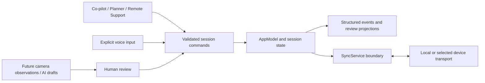
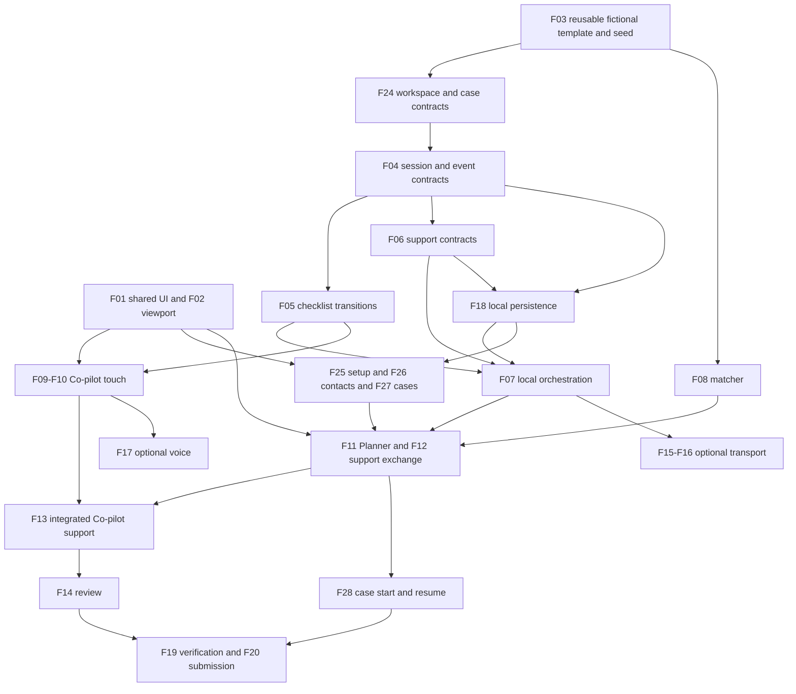

# Northstar OR: product implementation plan

Planning baseline: `main` at `ff639ed`, inspected on **2026-10-24**. This is an implementation blueprint, not a claim that pending features are shipped. Recheck the task board and open PRs before claiming a slice; estimates and priorities must change when the baseline changes.

Presentation review: the owner's subsequent scope edits were checked against `29d999f` on 2026-10-24; app code was unchanged. Keep one coordinator plan, no Planner preparation checklist, a pinned warning item, and fixture/contracts-first implementation. [DEMO_READINESS.md](DEMO_READINESS.md) defines the presentation proof matrix, timed primary path, alternate-path checks, and submission gate. No rehearsal or readiness is claimed by writing these plans.

**Scope correction, owner-confirmed on 2026-10-24:** the presentation is **five minutes** and must demonstrate a configurable app, beyond a prepared case. [PRODUCT_FOUNDATION.md](PRODUCT_FOUNDATION.md) makes blank setup, managed contacts, case creation/start/resume, retained records and independent second-case verification core work. It supersedes the older single-seeded-case and optional-persistence minimum. [DESIGN_REFERENCES.md](DESIGN_REFERENCES.md) records institutional software research and the resulting design decisions. These remain planned capabilities.

The product scope stays in [PRODUCT.md](PRODUCT.md), visual and interaction rules in [DESIGN.md](DESIGN.md), and ownership/completion in [TASKS.md](TASKS.md). This document supplies the implementation detail behind those documents. Proposed names below describe contracts; adapt them to the existing code rather than introducing an architecture rewrite.

## 1. The outcome we are building toward

Northstar OR is a shared coordination workspace for a fictional rural OR team and a technical device-support representative. Its central promise is: **the team can see who is supporting the case, record what people explicitly confirmed, ask for help with useful context, and review what remains unresolved.**

The primary product is the connected journey across three destinations. A polished isolated dashboard, an attractive voice visualization, or an AI chat window does not demonstrate that journey.

| User | Job | Evidence that the product helped |
| --- | --- | --- |
| Coordinator | Understand disrupted coverage and arrange a named support resource | Can explain the logistical constraint, request an appropriate role, and distinguish an available option from an accepted arrangement |
| OR team member | Record team-reported progress and request technical help without losing context | Can confirm, defer, correct, and ask a question; unresolved work remains visible |
| Technical device representative | Join with the actual question and respond with context | Sees the question, snapshot time, unresolved items, and recent events; can acknowledge and reply |
| Session reviewer | Understand what was recorded and by whom | Can distinguish original records, corrections, outstanding items, support exchanges, and information sources |

There are three different delivery targets:

1. **Configurable evaluation app:** fictional workspace setup, managed contacts, ordinary case creation from a supported template, guarded touch workflows, explicit support exchange, retained records/drafts, and a restrained adaptive UI. Present a selected journey through that app in five minutes.
2. **Evaluable product prototype:** repeatable multi-device exchanges, recovery, bounded persistence, usability evidence, and well-defined ownership of the record. Still simulated data.
3. **Candidate for institutional evaluation:** a separately scoped program with workflow partners, security and privacy owners, content governance, operational support, and formal entry criteria. Visual polish and passing CI do not establish this status.

The full blueprint is larger than the remaining hackathon. Deliver the smallest repeatable version of target 1 first; use targets 2 and 3 as an ordered continuation. A local prototype can have functional setup and persistence while its remote transport and institutional deployment remain unfinished.

## 2. Verified starting point and highest-priority gaps

The starter has SwiftUI tabs, shared in-memory state, a deterministic matcher interface with an injectable time argument, touch progress controls, speech output, a voice parser/service, and six existing unit tests. The approved identity and restrained shared styling are merged. No open PR was present when this plan was started.

| Area and current source | What exists | Gap the implementation must resolve |
| --- | --- | --- |
| [Theme](../NorthstarOR/DesignSystem/NorthstarTheme.swift) | Tokens, neutral fixed-size fonts, flat primary button | Dynamic Type scaling, 13 pt supporting-label baseline, meaningful status contrast, disabled/focus/secondary controls |
| [RootView](../NorthstarOR/App/RootView.swift) and [project.yml](../project.yml) | Three tabs and declared landscape iPad orientations | Verify actual viewport/letterboxing on the target device; define adaptive shared context and case selection |
| [Models](../NorthstarOR/Models/Models.swift) | Procedures, reps, four step states, text log entries | Selection is mixed with completion status; no session-scoped support arrangement, question, receipt, correction, or source contract |
| [CoPilotSession](../NorthstarOR/Features/CoPilot/CoPilotSession.swift) | Complete, skip, acknowledge, sequential advance, in-memory log | Mutating methods do not guard pending acknowledgment; repeated completion can advance multiple items; no correction or arbitrary selection |
| [CoPilotView](../NorthstarOR/Features/CoPilot/CoPilotView.swift) | Fixed 300/320 pt sidebars, current task, recent log | Adaptive layout, persistent unresolved summary, correction and request actions; replace full-screen warning border and ambiguous completion copy |
| [CoverageMatcher](../NorthstarOR/Features/Planner/CoverageMatcher.swift) | Skill/travel/closure rules, reasons, ranked options | Remote options ignore `isAvailable`; some reasons attribute lack of coverage to roads even when that is not the cause; Reschedule is appended as matcher output rather than a plan the coordinator explicitly commits to |
| [Planner](../NorthstarOR/Features/Planner/PlannerView.swift) | Case list, reasons, ranked text options, reduced-support flag | No explicit one-plan choice (named rep or reschedule), acceptance flow, or coordinated active-session switch |
| [ContextPackage](../NorthstarOR/Features/RemoteSupport/ContextPackage.swift) | Current step, skipped items, recent log | No actual question, recipient/role, session ID, snapshot version, or deliberately shared evidence; escalation is tied to deviations |
| [Remote Support](../NorthstarOR/Features/RemoteSupport/RemoteSupportView.swift) | Hard-coded sender and quick prompts, local message send | Explicit request and acknowledgment, role identity, conversation, retained draft on failure; remove clinical-direction quick prompts |
| [SyncService](../NorthstarOR/Services/SyncService.swift) and [AppModel](../NorthstarOR/App/AppModel.swift) | Void sends and same-process subscriptions; two event types applied to active session | No cross-device transport, receipt evidence, duplicate/replay protection, recovery protocol, or explicit UI-isolation contract |
| [Voice service](../NorthstarOR/Services/VoiceCommandService.swift) | Permissions, recognition, substring parser | Not wired to UI; negated or incidental phrases can match; partial results can repeat; on-device support is conditional |
| [SampleData](../NorthstarOR/Data/SampleData.swift) | Fictional people/sites, relative schedules, implant checklist | Clinical-direction copy and reused implant steps for ICD. Keep Worthington and Bemidji on the planner list so ranking stays visible. The ICD row must not become the active co-pilot checklist |

These are source-review findings, not a fresh device or accessibility audit. The existing tests do not establish delivery reliability, voice accuracy, interaction quality, or clinical suitability.

## 3. Scope and the complete demonstration journey

### Required core

- A configurable fictional workspace, support directory and normal case-creation flow using a versioned pacemaker coordination template. Optional sample data uses the same repository and actions; new cases do not require sample IDs.
- Named technical-support role, one committed plan (request one named rep, or mark to reschedule), explicit acceptance for the named-rep branch, and a separately displayed connection mode. Unchosen options stay visible as backup; before commitment the plan is unset.
- Team-reported item confirmation, deferral, acknowledgment, and correction through touch. A pending acknowledgment pins the selected item. Requesting support stays available during that warning.
- Support requested at any time with the team's question and a timestamped context snapshot.
- Recipient acknowledgment and a technical-support reply surfaced in Co-pilot.
- Retained review of unresolved items, confirmations, corrections, support exchanges and drafts, with tested relaunch/start/resume across at least two cases.
- Readable, adaptive layouts using the approved brand and design guide.
- A clearly labeled local demonstration if cross-device transport has not passed its gate.

### Conditional additions after the core passes

Voice, separate-device transport, a narrow mock-label camera observation, and session-grounded AI drafts each have their own acceptance gate. Add them individually. Durable local storage, normal setup and repeatable case creation are core. Maps, live weather, broad procedure content, video calls, EHR integration, and automated interpretation of surgical activity remain outside the required build.

### Script and expected record

| Moment | User action and visible result | Record or state that must exist |
| --- | --- | --- |
| 1. Coverage disruption | Coordinator opens the Grand Marais fictional case; sees 110-minute travel and road closure in 90 minutes | Simulated forecast/time label, logistical risk reasons, no assertion about whether the case can proceed |
| 2. Arrange support | Coordinator commits to one plan: request Ana, request Marcus, or mark the case to reschedule. Unchosen options stay visible as backup | A named-rep plan is requested, and remote capability is not acceptance. Reschedule is recorded without a rep acceptance. The backup is not a second live request |
| 3. Accept | Rep explicitly accepts in the support view | Accepted actor/time; connection mode shown separately; in one process, role switching remains labeled as a demo |
| 4. Record progress | Team records a confirmation and deliberately defers a required fictional item | Explicit action source/time, deferred state, required acknowledgment |
| 5. Ask while the warning remains | Team asks “Which mock model reference should we use?” | Exact question, recipient, session/case IDs, snapshot time/version, unresolved items, relevant recent events; warning and selected item remain |
| 6. Acknowledge the warning | Team returns and acknowledges the alert | Alert gate clears; the item remains selected/deferred and the unresolved count remains |
| 7. Respond | Rep acknowledges and replies with a fictional technical reference | Recipient acknowledgment and reply are separate events; Co-pilot shows the new reply prominently |
| 8. Correct and review | Team corrects a previously recorded item, then opens review | Original event remains; correction identifies its target; review still shows any unresolved item |

The table is an example fixture journey, not an application restriction. The five-minute presentation shows workspace settings, a newly created fictional case, the core support loop and persisted resume. Rehearsal may choose Ana and the Grand Marais story, but configured contacts/sites and every compatible newly created case must use the same behavior. Marcus, reschedule, plan replacement and failed send remain independently verified branches. Reschedule records a coordinator's planning choice without changing an external booking. Supported cases can explicitly start/resume their own sessions; the unsupported ICD template remains unavailable.

A separate failure rehearsal disconnects the transport or injects a send failure. The app must preserve the question, show the actual failure or pending state, and avoid claiming delivery. This failure rehearsal is required even if the presentation uses the happy path.

## 4. Shared state contracts to settle before feature UI

### 4.1 Case, session, actors, and time

- Keep `Procedure.id` as the fictional scheduled case identifier. Add a unique **session ID** per run; case ID alone cannot isolate a reset or a second run of the same procedure.
- Keep `selectedCaseID` for Planner browsing separate from the optional active session. Store sessions by workspace/case/session identity; starting/resuming another supported case is explicit, retains prior records/drafts, and cannot bypass a pending acknowledgment. Blank installation has no active session. F24 defines setup/case/template types; F18 supplies the repository.
- Use stable IDs for participants and their stated role. Device-rep technical support and clinical specialist support are different roles. Demo role selection is simulated identity, not authentication or credential verification.
- Store absolute timestamps and format the relevant date/time zone for coverage. Inject the clock for fixtures and rules. A relative forecast needs an `asOf` time so “90 minutes” does not restart on every refresh.
- Show a session version or last-updated time where stale context matters. Do not derive causal ordering from two devices' wall clocks.

### 4.2 Checklist and acknowledgment

Proposed domain shape: item status is `unrecorded`, `deferred`, or `teamConfirmed`; `selectedItemID` is independent. Keep a separate acknowledgment record linked to the deferral event/item.

| Action | Preconditions | Result and invariant |
| --- | --- | --- |
| Select item | Item belongs to active session, and no acknowledgment is pending | Changes selection only; no completion, no implicit confirmation. A pending acknowledgment pins the current item |
| Record confirmation | Known target item and current session; no blocking acknowledgment; intent has not already applied | Target becomes team-confirmed and exactly one event is appended |
| Defer item | Known target; no blocking acknowledgment; explicit user intent | Item becomes deferred; required acknowledgment is created when applicable; no automatic completion |
| Acknowledge | References the currently pending acknowledgment ID | Records that the warning was seen; leaves the underlying item deferred |
| Correct record | Names the original event/item and new recorded state | Appends a correction with actor/source/time and reason where supplied; original record remains visible |
| Request support | Nonempty question and chosen recipient/role | Allowed with zero deviations and while an acknowledgment is pending |
| Open review | Active session exists | Shows the record and unresolved work; never certifies the procedure |

Choose a narrow gate: while acknowledgment is pending, block confirmation, deferral, and any change of the selected item, across touch, voice, keyboard, and remote commands. Keep support request, review, and correction of the pinned item available. A correction that invalidates the triggering deferral supersedes its gate through a logged transition; it must not silently acknowledge it. Requesting support during the warning does not clear the warning or move the selection.

The required-item deferral must pin the **item just deferred**, before any sequential advance; the starter's skip-then-advance behavior must change. Acknowledgment clears only the gate and leaves that item selected and deferred until the user explicitly navigates or corrects it. Opening/closing support or review, changing tabs, and receiving a reply do not change the selection. Review is read-only while this gate is pending except through the pinned item's explicit correction action.

Every checklist mutation carries a stable intent ID, session ID, target item ID, and expected relevant state/version. Disable buttons while applying an action, but enforce the rule in the domain layer too. Duplicate callbacks are no-ops. A stale voice or touch intent must be rejected or reviewed against its original target rather than applied to the next item. Deliberately taking the same action on another item remains possible with a new intent.

“Checklist complete” requires all items in the displayed checklist to be team-confirmed, with no deferred or unrecorded items. If the team has merely browsed all items, use “Review session” and display unresolved counts. Completion never describes clinical readiness or outcome.

### 4.3 Coverage arrangement is different from a question

Create two concepts:

1. **Support arrangement:** who has been asked to cover the session, in what role and mode, and whether they accepted.
2. **Support request:** a specific question/context exchange during that arrangement, with its own acknowledgment and messages.

Do not overload one `reducedSupport: Bool` to represent all of this. It may remain temporarily as a compatibility projection during migration, but it must not create acceptance.

| Domain | Minimum state / fields | Important transition |
| --- | --- | --- |
| Coordinator plan | Case ID, plan ID/revision, one named-rep request or mark-to-reschedule, author/time, current/superseded | Initially unset; only a deliberate coordinator action commits or replaces a plan |
| Arrangement | ID, session, requested recipient/role, mode, requested/accepted/unavailable, timestamps | Only an explicit recipient action produces acceptance; declining/unavailable retains a visible outcome |
| Question request | ID, session, author/recipient, actual question, snapshot, open/acknowledged, timestamps | Acknowledging this question does not confirm any checklist item or resolve the question automatically |
| Connection | Local demo / connecting / connected / reconnecting / disconnected, peer and last contact | Acceptance survives a disconnect; current connectivity does not |
| Message | ID, request/session, sender/recipient, body, local/send/receipt state | Sender submission, receiver receipt, and human acknowledgment are different facts |

The UI may display “not requested” when no arrangement exists. “Connected” is derived from a live connection plus the appropriate participant, rather than replacing the arrangement's accepted state. The coordinator's active plan is exactly one of: a request to one named technical rep, or reschedule. Reschedule is a recorded plan with no recipient and no acceptance step. Switching plans replaces the previous one and preserves its history. Options that were not chosen stay visible as backup and are not a second live request. Start with one accepted technical recipient per session. Multi-party clinical coverage is later scope.

Plan replacement is a validated command referencing the expected current plan ID/revision. Supersede the old request and create the new plan as one local transition. Every acceptance references its arrangement and plan IDs; a late acceptance of a superseded plan cannot reactivate that rep, create a second accepted plan, or change the current header. Preserve the old event as historical/stale rather than silently representing it as current. A former option remains a candidate only if still eligible, with its current availability visible; historical acceptance is not acceptance of a new request.

“Mark to reschedule” records the coordinator's intent inside this prototype. It does not claim a new date, change an external schedule, stop a clinical procedure, or erase an existing session. A later switch back to a rep requires a new explicit request and acceptance. A team's contextual question has its own chosen recipient and may still be sent when no coverage plan is accepted; sending it never commits a coverage plan implicitly.

### 4.4 Context, event history, and receipt evidence

Extend `ContextPackage` into a **request-time snapshot** with session/case IDs, question, named recipient/role, selected item, all unresolved items, recent relevant events, capture time, and source version. Keep the original snapshot stable after sending. Later changes appear as labeled newer activity or a deliberate refreshed snapshot.

Use structured events for state changes; render human-readable `LogEntry` text from them or attach structured metadata during a staged migration. Required metadata: event ID, intent ID when applicable, session/case ID, event kind, entity/target ID, actor ID/role, input source, occurrence time, and accepted session sequence/version. Correction events reference the prior event. Avoid building two independent sources of truth for the same status.

In-memory implementations remain useful for tests/previews, but the revised product core requires F18's versioned local persistence. Preserve prior event/correction history and restore the accepted state consistently. Neither an append-only UI projection nor a local file establishes immutable or institutionally authoritative audit storage.

For cross-device delivery, add a versioned event envelope and per-recipient receipt tracking. A message can be labeled delivered only after the receiving application has applied it and returned its ID. Human acknowledgment is another explicit event. On reconnect, compare session/version and request a snapshot or missing events; discard duplicates and reject incompatible sessions/schema versions visibly. Reset starts a new session ID, preventing late events from reviving an old run.

## 5. Architecture and migration approach

Retain SwiftUI, Observation, the pure matcher, and the existing `SyncService` boundary. No new framework or runtime provider is selected by this document.

- Keep mutable presentation/session state on the main actor. Transport callbacks arrive through one controlled hop before modifying observable state. Test this boundary when adding asynchronous delivery.
- Views invoke domain actions, rather than writing statuses or interpreting network callbacks. Touch, voice, and keyboard share those actions and their preconditions.
- Keep `CoverageMatcher` pure. Inject time, scenario inputs, and rule parameters; return reasons with the actual constraint, rather than a generic road-closure explanation.
- Grow `AppModel` only with shared coordination responsibilities. Inject repository/seed dependencies rather than unconditionally loading SampleData or `procedures[0]`. Represent no workspace/case/active session explicitly. Keep checklist transitions in `CoPilotSession`; extract small support-state types as needed.
- Evolve `SyncService.send` to provide an asynchronous submission outcome and observable connection/receipt events. Preserve a local implementation and an injectable failure/duplicate/reorder test implementation.
- Choose one authority for each domain in the first multi-device prototype: OR host owns checklist/session sequence; the selected recipient owns its acceptance, acknowledgment, and reply intents. The host validates and applies those intents. Do not let two devices independently overwrite checklist dictionaries.
- A server implementation can later own sequencing. Automatic host election, multi-writer offline merge, and seamless failover are outside the initial prototype. On host loss, show disconnected and limit remote mutations until explicit reconnection/recovery.
- Migrate in compiling slices: introduce contracts and compatibility adapters; move one domain action at a time; update tests and consumers; remove obsolete `StepStatus.current`/`skipped`, text-only routing, and boolean shortcuts once no consumer relies on them.

Proposed placement: shared identities/events/configuration in `Models/`; orchestration in `App/AppModel.swift`; setup/settings/directory in `Features/Workspace/`; case forms/worklist in `Features/Planner/`; checklist transitions in `Features/CoPilot/`; support views/context in `Features/RemoteSupport/`; transport/voice/persistence implementations in `Services/`; fixtures in `Data/`; reusable UI in `DesignSystem/`. Shared changes get their own PR before dependent screens.

## 6. Screen-level implementation specification

### 6.1 Shared shell and components

The shell consistently identifies the active fictional case, facility, unresolved count, support role/state, and actual communication mode. Keep the logo modest. Planner's browsed selection remains separate from this active-session context.

First launch offers actual workspace setup or explicit sample loading. Later launch restores the configured workspace/worklist; it never silently resets into a preselected sample session. Workspace settings are available from the shell. See PRODUCT_FOUNDATION.md for fields, empty states and storage; see DESIGN_REFERENCES.md for the institutional worklist/context/header direction.

Build only components needed by at least one immediate screen: status label, persistent attention banner, primary/secondary action, section heading, empty/error state, and readable event row. A reusable case header can follow after the shell/feature boundary is clear. Do not create a large unused component library.

Use semantic/scalable fonts, 13 pt minimum default metadata, existing spacing/radii, and verified foreground/background pairs. Default primary hit areas are at least 72 pt high and wide; other targets 44 × 44 pt with 8 pt separation. Disabled and focused states must remain legible and discoverable. See DESIGN.md for exact contrast and accessibility evidence.

Verify landscape presentation with the actual generated project and installed iPad runtime before changing settings. Inspect the generated Info.plist and scene/launch configuration if letterboxing persists. Change `project.yml` only for a demonstrated cause; do not commit the generated project or disable resizing to hide a layout problem.

### 6.2 Co-pilot

**Hierarchy:** case/support context → persistent unresolved/acknowledgment banner → current selected item → actions → secondary progress/history.

- Wide layout: progress list, dominant work area, recent activity. Use three regions only while the work area can remain at least 360 pt wide.
- Narrower windows or large text: move history to a labeled sheet/detail or stack it, preserving current actions and support access. Rows wrap and scroll; text never shrinks to conceal overflow.
- Progress rows are selectable and show recorded status with icon/text. Selection uses the informational accent, separate from confirmation green.
- Main actions: “Record confirmation” and “Defer item.” Provide a secondary correction action on recorded items and always-available “Request support.” Bind each action to the displayed item's ID and state version.
- Required deferral: show a named persistent banner with “Acknowledge.” Speak once for the new event when audio is enabled; remove the decorative full-screen border. Acknowledgment changes the gate, not the deferred item. While the banner is up, the selected item stays pinned. Confirm, defer, and selecting another item are unavailable. Request support, review, and correction of the pinned item stay available.
- New support reply: show sender/role, excerpt, and “View reply.” Do not steal text-entry focus or automatically scroll someone away from older activity. Unread state means locally unviewed, not a claim that the sender knows it was read.
- Review entry remains available; show a factual unresolved count. Timer is secondary and does not produce repeated VoiceOver announcements.

**Acceptance:** confirmation/defer/ack/correction/request are possible by touch at default and enlarged text; a pending gate blocks confirmation, deferral, and item switching from every input; request support still works during that gate; deferred state survives acknowledgment/tab changes; reply is visible without opening a different tab first.

### 6.3 Planner

**Hierarchy:** case list and labeled coverage risk → selected case → constraint reasons → named options, including reschedule → one active plan and its acceptance state.

- Case rows show fictional facility/town, schedule/time zone, device family, and icon/text coverage risk. An empty selection explains what to choose.
- Explain options with skill compatibility, simulated availability, travel/setup window, closure window, and remote capability. Show missing/unknown inputs explicitly. Avoid an opaque “score” unless an actual scoring function is implemented and explained.
- Filter unavailable reps from immediately actionable options or display them in a clearly unavailable group. Never offer an unavailable remote rep as an available default.
- Keep Reschedule as a real option the coordinator can commit to, alongside requesting Ana or Marcus. The matcher may rank it. It must not apply itself. Committing to it records that plan and does not invent a rep acceptance. Preserve the logistical reason.
- Selecting an option opens its details. “Request support arrangement” on a named rep creates one request; the result says “Awaiting acceptance.” Only the recipient can produce acceptance in the demo role flow. “Mark to reschedule” records the reschedule plan. One plan is active. Choosing another replaces it and leaves the previous option visible as backup, not as a second live request.
- The Planner does not collect a preparation checklist. The coordinator's actions end at reading the risk, committing to one plan, and watching whether a named rep accepts.
- “New case” and workspace-directory/settings actions use normal validated forms. A selected non-active case cannot mutate the current session by accident. Explicit start/resume restores its own record. Sample Worthington and Bemidji rows may illustrate ranking, but arbitrary compatible cases are supported; only unsupported workflow content such as the reused ICD checklist is blocked.

**Acceptance:** high-risk scenario reasons are reproducible; availability is distinct from capability and acceptance; missing drive/forecast/qualification inputs do not create false certainty; browsing another case leaves Co-pilot untouched.

### 6.4 Request composer and Remote Support

**Composer:** recipient and technical role → team's question → context preview and snapshot time → explicit send.

- Requesting help never requires a skipped/deferred item. Allow it while an acknowledgment banner is present.
- Validate whitespace-only text and missing recipient locally. Show the actual question in the receiving view.
- Preserve a draft across tab changes, sheet dismissal, keyboard changes, and a failed attempt; deliberate discard is explicit. Durable draft recovery after app termination belongs to the persistence slice.
- Context preview includes unresolved items, selected item, and bounded recent activity. Future attachments require deliberate selection; camera access does not automatically share a stream or image.
- The support view presents arrangement invitations separately from question requests. “Accept support arrangement” and “Acknowledge question” have different effects.
- Conversation shows sender/role, timestamp, send/receipt state, and retry where supported. Bind retry to the same message ID to avoid a second logical request.
- Use a text reply or coordination-only quick replies such as “Request received; reviewing the shared context.” Remove prompts that direct surgery or imply permission to continue.
- Keyboard-safe entry and a visible send action are required. Keep connection loss and unavailable recipients visible without clearing the conversation.

**Acceptance:** zero-deviation request succeeds locally; the recipient acknowledges the exact request; a reply appears prominently in Co-pilot; failures retain text/context; no “delivered” or “acknowledged” label exists without corresponding evidence.

### 6.5 Session review

Place review within the current session, initially as a sheet or detail view; do not add a fourth main tab. Present session identity and communication mode first, unresolved items next, then confirmations/corrections and support exchanges with actor/source/time.

Offer a chronological record and a compact grouped summary from the same retained events. Show original and corrected records together. Distinguish a human confirmation, a received message, and any future automated observation. F18 restores this record and drafts after relaunch; pending sends require reconciliation, never assumed delivery. Export, sign-off, EHR write-back, and legally authoritative records are separate decisions.

**Acceptance:** counts match domain state; corrected records retain history; acknowledged deferrals remain unresolved; ending navigation does not imply that the clinical procedure ended.

## 7. Implementation backlog: small, dependency-sized PRs

The IDs below identify planned slices, not claims or GitHub issues. Claim the corresponding task in TASKS.md before work. A row that grows beyond a focused review should be split, keeping the same outcome and dependencies. Do not combine shared interfaces with every dependent screen in one PR.

Priority **P0** means necessary for the smallest configurable product and its five-minute presentation. **P1** strengthens communication/input after that path works. **P2** is an optional extension. Lane labels indicate folder ownership; they do not authorize spawning more agents. F24–F28 extend the original IDs; F18 is promoted to P0.

| ID | Priority / owner | Branch suggestion | Depends on | Concrete deliverable |
| --- | --- | --- | --- | --- |
| F01 | P0 / shared design | `pitch/accessible-components` | Current main | Scalable typography, readable status treatment, accessible action/banner primitives |
| F02 | P0 / shared app shell | `pitch/adaptive-app-shell` | Current main; F01 for final visuals | Diagnose viewport, adaptive shell, stable navigation and active-case presentation |
| F03 | P0 / shared data + coordinated copy | `pitch/coherent-demo-fixture` | Current main | Versioned fictional pacemaker coordination template and optional seed factory; arbitrary case/contact IDs; normal empty entry; unsupported ICD content cannot launch |
| F04 | P0 / shared contracts | `sync/session-event-contracts` | F03, F24 | Workspace/case/session/actor/source IDs, structured intents/events, independent item/selection and acknowledgment types |
| F05 | P0 / Co-pilot state | `copilot/explicit-recording-state` | F04 | Guarded confirmation/defer/acknowledgment/correction with idempotence and target validation |
| F06 | P0 / shared support contracts | `sync/support-state-contracts` | F04 | One coordinator plan/revision, named arrangement or reschedule, supersession, question, immutable snapshot, and message/receipt identities |
| F07 | P0 / shared orchestration | `sync/local-support-journey` | F05, F06, F18 | Repository-backed local arrangement/request/ack/reply, main-actor routing, case/session isolation and injectable failures |
| F08 | P0 / Planner matcher | `planner/explainable-coverage` | F03 | Availability handling, truthful constraint reasons, explicit Reschedule candidate without automatic commitment, no-option explanation and boundary tests |
| F09 | P0 / Co-pilot layout | `copilot/adaptive-workspace` | F01, F02, F05 | Responsive progress/work/activity hierarchy, explicit actions and persistent unresolved display |
| F10 | P0 / Co-pilot interaction | `copilot/recording-and-corrections` | F09 | Reviewable confirmation/defer/ack/correction interactions; focused behavior/visual verification |
| F11 | P0 / Planner UI | `planner/support-arrangements` | F01, F06, F07, F08, F26, F27 | Configured case/contact detail, one rep-or-reschedule plan, visible backup and actual acceptance. No preparation checklist |
| F12 | P0 / Remote Support | `planner/contextual-support-exchange` | F01, F06, F07, F26, F27 | Rep join brief built from the request snapshot; configured sender/recipient, question composer, acceptance, acknowledgment, reply and retained failure draft |
| F13 | P0 / Co-pilot integration | `copilot/support-reply-and-request` | F10, F12 | Always-available request entry, contextual banner, recipient/role and prominent incoming reply |
| F14 | P0 / review | `copilot/session-review` | F05, F07, F13, F18 | Retained unresolved-first review with corrections, sources, support history and resumed case identity |
| F15 | P1 / sync spike | `sync/transport-proof` | F06, F07; devices chosen | Time-boxed real-device proof and decision record; no production delivery claim |
| F16 | P1 / sync implementation | `sync/device-receipts-and-recovery` | F15 passes | Selected transport, connection state, application receipts, deduplication, reconnect and stale-session rejection |
| F17 | P1 / Co-pilot + voice | `copilot/explicit-voice-commands` | F05, F10 | Bounded parser, listening state, explicit permissions/capability, one command application, touch fallback |
| F18 | P0 / services + shared state | `sync/session-recovery` | F24, F04, F06 | Versioned local repository for workspace/contacts/cases/sessions/drafts; explicit save errors, corruption/schema and relaunch recovery; no assumed delivery |
| F19 | P0 / integration and workflow feedback | `pitch/core-journey-verification` | F11–F14, F25–F28; include P1 only if passing | Blank setup, independently created second case, input change, relaunch/isolation, accessibility/failure and workflow evidence |
| F20 | P0 / pitch | `pitch/demo-submission` | F19 gates final assets; script/deck draft starts at F03 | Timed script, owner-assigned slides/operation, accurate capability claims, verified-build backup and submission checks from DEMO_READINESS.md |
| F21 | P2 / shared observation contract | `sync/observation-review-contract` | Stable core, F04 | Evidence/source/review states for optional observations, no automatic checklist mutation |
| F22 | P2 / camera | `copilot/mock-label-observation` | F21; explicit mock dataset | Single captured label, extracted text, proposed comparison, human confirm/correct and unknown state |
| F23 | P2 / AI | `sync/reviewable-handoff-draft` | Stable review/events; provider decision | Grounded summary/draft service through SyncService, evidence links, review-before-share and unavailable state |
| F24 | P0 / shared models | `sync/workspace-case-contracts` | F03 | Workspace/site/contact/template/case contracts, stable IDs and pinned reviewed template version |
| F25 | P0 / workspace UI | `pitch/workspace-setup` | F01, F02, F24, F18 | Functional blank setup/settings and explicit optional sample loading, retained after relaunch |
| F26 | P0 / workspace directory | `planner/support-directory` | F25, F24, F18 | Add/edit fictional support contacts, roles, capabilities and availability; same contacts drive requests |
| F27 | P0 / Planner forms | `planner/case-creation` | F25, F24, F04, F18 | Validated new/edit case from supported template; multiple independently named cases without seed IDs |
| F28 | P0 / Planner and app orchestration | `planner/case-start-resume` | F27, F05, F07, F11, F18 | Useful worklist/filter and explicit start/resume retaining separate case records, drafts and acknowledgment gates |

### Foundation PR review criteria: F01–F04

- **F01:** show reusable components at default, XXXL, and largest accessibility text; measure relevant contrast pairs including essential icon/boundary states. Demonstrate touch/keyboard focus and Reduce Motion. Do not add tests that merely assert token literals.
- **F02:** record actual device/runtime/window dimensions, investigate the letterbox cause, and verify safe areas, tab navigation, narrowed window, and keyboard. Any project setting change must name the observed cause. Coordinate case/role fields with F04/F06 instead of inventing parallel booleans.
- **F03:** keep source fixtures/templates under Data; inject clock/IDs and use as-of times. Optional sample loading creates ordinary records, never a special script state machine. Empty repository is valid; a new case can use the supported template without Grand Marais/Ana/array-index assumptions. Unsupported ICD content stays unavailable.
- **F04:** encode/decode the shared event/intent envelope, verify stable identities and source labels, and keep existing consumers compiling through a small adapter. Declare supported schema version and invalid-input handling. Avoid a broad persisted-data migration before persistence exists.

### State and orchestration review criteria: F05–F08

- **F05:** prove that required deferral pins that item before advance; acknowledgment keeps it selected/deferred; pending acknowledgment rejects item switching from domain methods and every UI route. Duplicate/stale intents cannot advance another item; corrections preserve history; selection alone changes no recorded status. Support/review/tab return and incoming replies preserve the pinned selection. Tests call domain methods directly, not only disabled UI buttons.
- **F06:** demonstrate that coordinator plan, arrangement acceptance, transport connection, question acknowledgment, and checklist confirmation are independently representable. Represent unset, rep, reschedule, and superseded plans; require plan IDs/revisions for acceptance. Snapshot the exact question and unresolved items; serializing it must not depend on live view references. For the F12 join brief, the snapshot also carries the sender's stated role, the current plan with its recorded logistical reason (or none), the confirmed-item count with the most recent confirmation, and the snapshot time.
- **F07:** route all local support actions through validated application commands and SyncService where they cross feature/device boundaries. Reject wrong-session and obsolete-plan activation, avoid subscription retain cycles, retain drafts until a successful local submission, and support deterministic failure/duplicate tests. Verify Ana → Marcus with late Ana acceptance, rep → reschedule with late acceptance, and reschedule → new rep request. Mark local interactions as local.
- **F08:** cover unavailable remote reps, no qualified rep, missing drive time, absent forecast, setup/closure equality, past schedule, and tied options with stable ordering. Choose and document boundary policy. Assert reasons identify the actual failed constraint and risk remains logistical. No opaque numeric score is required. The high-risk Grand Marais case offers named remote reps and Reschedule as choices. Committing to Reschedule is a later UI action, not something the matcher applies.

### Screen and integration review criteria: F09–F14

- **F09/F10:** verify the displayed target remains the command target, primary actions survive larger text, a deferred item remains available for correction, and pending acknowledgment cannot be bypassed by alternate input. While the warning is up, selecting another item fails and request support still succeeds. Keep evidence of warning and review states.
- **F11:** demonstrate independently created browsed/active cases without cross-contamination, no-result/unavailable options, one plan, unrequested backup, pending/accepted arrangement and explicit reschedule. Do not add a preparation checklist. Supported cases can explicitly start/resume; unsupported templates cannot launch.
- **F12:** render the join brief as a pure projection of the F06 snapshot plus later session events: question first, then case header, unresolved now, recorded so far, coverage plan/reason and a “Changed since request” count. Replace the live-session `ContextPackage`, hard-coded `repName` and `needsEscalation`. Unit-test the projection with zero, one and several deferred items, a missing plan/reason and events after the snapshot. Exercise a request with no deferred items, acknowledgment, one reply, failure/retry with the same message ID, keyboard occlusion, and draft preservation. Acceptance must not accidentally acknowledge the question. Remove hard-coded sender identity from the send path; use the simulated selected role.
- **F13:** support request remains accessible during a required acknowledgment; incoming reply shows the correct sender/session and does not change checklist state. A reply arriving while the team reviews history must not destroy their position or draft.
- **F14:** compare review totals to retained domain state; verify deferral plus acknowledgment, later correction, unanswered question, relaunch and correct case/session identity.

### Persistence and optional capability gates: F18 and F15–F17/F21–F23

- **F15:** two chosen physical devices exchange one session-scoped request and explicit application receipt, then disconnect and reconnect. Record permission/network/background behavior and SDK/deployment compatibility. Stop the spike after about 60–90 minutes if there is no reliable path; retain the labeled local demo.
- **F16:** the recipient applies an event at most once; receipt/ack labels are evidence-based; delayed events from a reset session are rejected; schema mismatch and host loss are visible; reconnect updates from a canonical snapshot or missing sequence range. Background/resume is part of the test, not an assumed guarantee.
- **F17:** use deliberately bounded command phrases such as “Northstar, record confirmation,” “Northstar, defer item,” and “Northstar, acknowledge warning.” Process a finalized command or explicit push-to-talk result, reject negation/extra ambiguous speech, and deduplicate recognition sessions. Test “do not complete,” incidental “next,” partial repeats, stale target, denied permission, unavailable recognition, audio interruption, and spoken-alert feedback. Avoid self-triggering from text-to-speech.
- **F18 (core):** persist one configured fictional workspace, contacts, cases, session states/events and drafts using a versioned atomic store. Exercise failed write, corrupt/version-mismatched data, relaunch mid-draft/send and explicit scoped sample reset. Restore pending sends for reconciliation, never as delivered. Use an in-memory store for tests/previews. Full field/rule acceptance for F24–F28 is in PRODUCT_FOUNDATION.md.
- **F21:** represent a captured observation, proposed comparison, and human confirm/correct/reject action separately. Keep an unknown outcome and evidence/source/time; round-trip the contract without marking an item confirmed. Sharing an observation requires an explicit request/message action.
- **F22:** evaluate independently labeled mock examples for readable/correct, readable/mismatch, blurred/unreadable, and absent label. Show the image, extracted text, comparison basis, and uncertainty. Record human correction separately. No clinical suitability/sterility/placement inference and no automatic completion. If extraction is not reliable, display “Unable to determine.”
- **F23:** restrict initial questions to unresolved confirmations, changes since a given event, and a handoff draft. Provide structured session evidence, preserve unknowns, identify supporting event IDs, and review before send. Model output has no direct access to mutation commands. Evaluate omitted deferrals, invented confirmations, injected instructions in message text, timeout, and provider failure. Select/credit a provider and define data sent before implementation.

## 8. Critical path, working order, and schedule

The path is **reusable template/seed → workspace/case/session/support contracts → retained state and setup → normal case/support journey → independent-case/relaunch proof → five-minute presentation**. First claim F03, then F24/F04/F06; F05 and F18 unblock F07 and setup/forms. Shared visuals can progress in a separate checkout. Feature UI waits for its merged contracts and storage.

This is a dependency map, not an instruction to run every node concurrently. [PARTNER_EXECUTION.md](PARTNER_EXECUTION.md) assigns Rahil shared contracts, Co-pilot, integration and review; Amartya owns shared UI, persistence, configuration/Planner and recipient support. Rahil takes F26 directory after setup to balance delivery. A single driver owns each shared-files PR; agree interfaces before feature branches diverge. With a single builder, use the topological order and cut optional work earlier.

Draft the presentation script and slide skeleton once F03 settles the scenario; F20 does not wait until the final hours to begin. Populate proof screenshots, capability labels, the backup recording and final timing only from the verified integrated build. DEMO_READINESS.md records the planned presentation roles; confirm them at kickoff and claim actual work in TASKS.md.

### Relative effort assumptions

Treat these as planning ranges for focused work on the current starter, excluding unexpected tool/device failures. They are not delivery commitments and must be re-estimated after contracts are settled.

| Workstream | Rough person-hours | How to reduce scope |
| --- | --- | --- |
| Shared UI, viewport, template/seed | 4–7 | Implement only the components and one supported coordination template needed by normal product flows |
| Checklist/support contracts and guarded local orchestration | 6–10 | One active recording context and one current technical recipient per case; keep independent retained sessions |
| Co-pilot, Planner, request/reply and review screens | 8–14 | One adaptive wide/stacked pattern; simple review sheet; no map or rich attachments |
| Manual evidence, focused tests, rehearsal and presentation | 4–7 | Keep one scenario and one failure drill; simplify presentation rather than dropping correctness checks |
| Configurable workspace, directory, case forms and persistence | 10–18 | One local workspace, small directory, one supported template, useful case worklist and bounded versioned store |
| Optional cross-device transport | 3–6+ after spike | Stop after failed spike; preserve honest local demo |
| Optional voice | 2–4+ with real-device time | Touch-only demo if command reliability or availability is unclear |

The revised core estimate is **32–56 person-hours**, superseding the prior 22–38 range for a narrower in-memory journey. This is a scope increase, not a deadline promise. Do not count two people as a perfect 2× speedup: shared-model merges, CI, device work and rehearsal remain serial. Protect setup, ordinary case creation, retained state and the support loop; cut advanced configuration, maps, camera/AI and unproven voice/transport first.

### Deadline-based cut lines

The recorded deadline is **Sunday, October 25, 2026 at 12:00 PM CT**. This plan was prepared Saturday afternoon CT; recalculate remaining time when using it.

| Gate | Decision and expected evidence |
| --- | --- |
| First 60–90 minutes of implementation | Confirm devices; claim F03 reusable content, then F24/F04/F06 contracts and F18 storage. Settle minimal setup/case fields and guards. Viewport work may run separately; do not start camera/AI |
| At least 12 hours before deadline | Exercise blank setup, a normal new case and the local support loop early. If behind, remove maps, extra template types, rich composition, advanced administration and unproven transport/voice; do not hide missing setup behind seed-only behavior |
| At least 6 hours before deadline | Freeze feature scope. Decide transport/voice inclusion from actual evidence; keep local/touch fallbacks. No new provider integration |
| At least 3 hours before deadline | Complete device rehearsal, unresolved-issue triage, accurate slides, credits and backup recording; fix only demo-blocking or correctness issues |
| Final hour | Confirm submission, repository/CI status and backup access; avoid risky redesigns or dependency upgrades |

If the minimum local support journey is still incomplete at the freeze, present only the working portion, label the rest as planned, and simplify the script. Never simulate acceptance/delivery labels behind the audience's back to make the journey look connected.

## 9. Transport and voice decisions that must remain honest

### Nearby demonstration versus geographically remote support

`LocalSyncService` is same-process only. Apple describes [Multipeer Connectivity](https://developer.apple.com/documentation/multipeerconnectivity) as communication with nearby devices. It can be considered for an in-room two-device demonstration; it does not by itself connect a hospital to a distant representative. Background/resume, permissions and actual hardware compatibility need testing.

For genuinely remote communication, evaluate an authenticated internet-backed transport through SyncService. Decide the network scenario first, then the provider. The spike must demonstrate connection, request, application receipt, disconnect, retry and session isolation on the intended devices. Compare setup time, available hardware, supported deployment targets, identity/access controls, and recovery needs. Do not add multiple backends during the hackathon.

Default decision until that proof passes: **keep the reliable local demo and label it**. A two-device nearby demo may be included if proven. The “storm” story may mean disrupted travel; do not imply distant remote support continues without an available communications path. A durable offline outbox is separate from successful delivery and is not implemented by merely retaining an in-memory message.

### Voice is an input method

Voice calls the same guarded commands as touch. Recognition is not inference of what happened in the room. Apple's [on-device recognition capability](https://developer.apple.com/documentation/speech/sfspeechrecognizer/supportsondevicerecognition) is conditional; the current service only requires on-device processing when that capability is present. Its “always offline” comment and permission copy therefore need review in F17.

For the prototype, prefer an explicit on-device-only mode: require supported capability and [on-device recognition](https://developer.apple.com/documentation/speech/sfspeechrecognitionrequest/requiresondevicerecognition); otherwise explain that voice is unavailable and retain touch. Do not silently switch processing modes or claim offline reliability from a parser unit test. Any network-backed mode would require its own explicit product decision and implementation.

## 10. Verification plan and definition of done

### Automated behavior coverage

Add tests when the corresponding behavior exists; do not add placeholders or assertions that merely repeat UI implementation.

| Layer | Required cases | Main failure this catches |
| --- | --- | --- |
| Checklist domain | Confirm/defer, acknowledgment invariants, correction, arbitrary selection, duplicate/stale target, pending gate from every action route | False completion or advancing an unrelated item |
| Support domain | Capability vs acceptance, one current plan, unset/reschedule, plan replacement/late old acceptance, arrangement vs question acknowledgment, request without deviation, wrong recipient/session, immutable snapshot | False coverage, two active plans, or context routed to the wrong session |
| Matcher | Availability, qualification, missing drive/forecast, setup/closure boundaries, elapsed schedules, stable ties, truthful reasons | Misleading logistical recommendation |
| App integration | Planner browsing vs active session; request → recipient ack → reply → Co-pilot; two separate sessions; reset | Cross-tab drift and record contamination |
| Transport, if included | Submit failure, duplicate/reordered event, receipt loss, retry, schema mismatch, host loss, reconnect snapshot and late old-session event | False delivery, duplicated mutation, silent stale state |
| Voice, if included | Exact accepted phrases, negation/ambiguity rejection, partial/final repeats, stale targets, permission/service failure | Accidental or repeated command application |
| Recovery, if included | Termination during draft/send, corrupt/version-mismatched file, explicit reset and deletion | Lost or falsely delivered records |
| Camera/AI, if included | Independent mock fixtures, unknown/mismatch, false match/missed observation, invented/omitted evidence, unavailable service | Automation being presented as observed or human-confirmed fact |

Keep the existing suite passing while changing its expectations where old semantics are deliberately replaced. In particular, update tests that treat `.current` as a recorded status. Keep Reschedule as an explicit option title. Update tests that treat the matcher's first option as a decision the coordinator already made. Run repository checks and `scripts/check.sh`; report actual test results and the simulator used. Required GitHub checks remain `Repository checks` and `iPad build and tests`.

### Manual evidence matrix

| Dimension | Evidence to record |
| --- | --- |
| Layout | Actual named iPad/runtime, landscape/window dimensions, safe areas, wide and narrower window; cause/resolution of unexpected letterboxing |
| Text | Default, XXXL and largest accessibility size; no clipped question/recipient/warning; essential actions reachable |
| Input | 72 pt primary / 44 pt other target checks, 8 pt gaps, touch journey, keyboard path/focus, VoiceOver reading order and control labels |
| Perception | Contrast of text/essential indicators, color-plus-icon/text, Increase Contrast and Differentiate Without Color, Reduce Motion |
| Error/recovery | Empty log, no option, recipient unavailable, pending acceptance, failed request, disconnected view and retry with retained draft |
| Physical device | Microphone/permission/audio interruption if voice included; gloves/noisy-room fictional walkthrough where feasible; connection background/resume if transport included |
| Product workflow | Fictional walkthrough with an OR staff member and device rep if available; record interruptions, confusing labels, missing context and changes needed, without real case data |

Store a compact record in a future `docs/validation/` note: commit, device/OS/window, settings, scenario, actions, expected/observed result, screenshot/recording location, issue, severity and owner. Mark unperformed checks explicitly. Unit tests and simulator screenshots are not substitutes for physical-device or workflow feedback.

### Core release gate

The demo build is ready only when all of these hold:

1. One clean run from reset reaches coverage review, explicit acceptance, touch confirmation, deferral, a contextual question while the warning remains, warning acknowledgment, explicit recipient acknowledgment, reply, correction and review.
2. Deferred items remain unresolved after acknowledgment; no input bypasses the gate or applies an old intent to the next item.
   The deferred item stays pinned while the gate is pending; support still works. Plan replacement, reschedule without acceptance, late old-plan acceptance, and secondary-case isolation pass their alternate-path checks in DEMO_READINESS.md.
3. Every support/transport label reflects implemented evidence; the local demo is clearly labeled when applicable.
4. Failed send and unavailable support are understandable; a draft survives the tested recovery path.
5. Named-size/enlarged-text evidence is reviewed, essential controls remain usable, and no known layout issue hides required actions.
6. Focused behavior tests, repository checks and required CI pass. Manual gaps are documented; a known failure that loses/misattributes records, creates false confirmation/delivery, or blocks the core journey prevents a readiness claim.
7. Slides, README, script, and credits describe the build actually being shown. Backup recording uses that same working build.
8. Complete the timed-run and submission evidence in [DEMO_READINESS.md](DEMO_READINESS.md). The planning document itself is not evidence that the app or presentation has passed.
9. Pass PRODUCT_FOUNDATION.md's blank-workspace, independently named contact/case, two-case isolation, input-change and relaunch tests. No hard-coded site/person/sequence may be required. Persistence and setup are core, not presentation-only placeholders.

## 11. After the hackathon: a disciplined path toward institutional evaluation

Continue simulated-data development under the current rules. Moving beyond that boundary requires a separately authorized scope, appropriate institutional owners, and a new evaluation plan. The sequence below is a planning framework, not a compliance determination or permission to deploy.

| Stage | Concrete work | Exit evidence |
| --- | --- | --- |
| Workflow discovery | Observe/review fictional workflows with OR staff, coordinators and device reps; clarify role boundaries, interruptions and existing communication tools | Prioritized user needs, role/task map, reviewed copy/content, explicit excluded uses and measurable evaluation questions |
| Robust simulated pilot | Authenticated participant model, session ownership, bounded storage/recovery, actual remote transport, accessibility/usability iteration | Repeatable end-to-end and failure tests, no unresolved false-state defects, task-level observations and documented changes |
| Institutional readiness planning | Work with institution-selected security/privacy, clinical workflow, IT and procurement owners to define permitted use, data flows, access, retention, device deployment and operational responsibilities | Reviewed architecture/data-flow/threat assessment, agreed data boundaries, content governance, incident/recovery ownership, and institution-specific entry criteria |
| Controlled evaluation | Run only the approved scenario with trained participants, agreed oversight, stop conditions and issue reporting | Recorded usability/reliability findings, resolution of blocking defects, accountable decision on any next phase |

Engineering work to scope during readiness planning includes real identity and role authorization, separation between institutions/sessions, access revocation, secure transport/storage, retention/deletion, audit requirements, backups, monitoring, incident handling, supported-device policy, managed deployment and support ownership. Decide these with the institution; demo role selection, append-only UI history, and an encrypted connection alone do not answer them.

Procedure content needs a named reviewer, version, references, approval/revision process, and visible applicability. A device rep's stated skills in SampleData are not verified credentials. Integrations with hospital records, external clinical systems, or real patient information must be separately scoped and evaluated; do not quietly grow them out of the simulated fixture model.

Evaluate product quality with task completion, time to find the question/unresolved items, correction success, support acknowledgment delay, failure recovery, accidental-command count, and user comprehension of state. Set targets after a baseline walkthrough. Do not invent satisfaction scores, accuracy rates, time savings, or clinical outcome claims.

## 12. Decisions, risks, and immediate next actions

### Decision log to resolve in order

| Decision | Proposed default | Evidence needed to change it |
| --- | --- | --- |
| First product scope | One configurable fictional workspace, contacts and multiple cases using one supported pacemaker coordination template | Separate reviewed template/content before adding another procedure type |
| Core input | Touch; explicit voice only after F17 passes | Physical-device command/noise/permission testing |
| Communication mode | Labeled local demo until a transport gate passes | F15/F16 end-to-end receipt/disconnect evidence |
| First remote participant device | Second iPad if available; otherwise verify actual available Mac/iPad build before choosing | Installed runnable build, pairing/permissions and usable role view; do not assume Mac compatibility from the project name |
| Session ownership | One active OR recording context; separate retained sessions per case | Concurrent multi-writer editing requires a separate conflict/authority policy |
| Record retention | P0 versioned local workspace/case/session/draft store | F18 relaunch, failed-write/corruption/schema and reconciliation tests; no institutional audit/backup claim |
| Optional automation | None required for the core | Working narrow camera/AI slice with reviewed fictional evaluation fixtures |

### Main risks and response

- **Shared-model conflicts:** land F04/F06 separately and early; one driver per shared slice; dependent feature work uses merged contracts.
- **Attractive but misleading states:** treat false confirmation/acceptance/delivery as blocking defects, even when the UI looks complete.
- **Voice uncertainty:** exact phrases, domain guards, deduplication, visible capability, touch fallback; cut voice if unproven.
- **Transport consuming the schedule:** time-box the spike, choose one path, retain local mode; never present nearby exchange as evidence of distant offline support.
- **Fixture drift:** injected clock, explicit reset/session IDs, one reviewed scenario, unsupported workflows excluded.
- **Polish displacing reliability:** resolve viewport, text scaling, unresolved states and failed-send recovery before optional maps or automation.
- **Hospital positioning outrunning evidence:** say professional prototype and report actual validation; institutional evaluation has its own owners and gates.

### The next work to claim

1. **F03 → F24 → F04/F06 → F05/F18 → F07:** settle reusable fictional template/seed content, workspace/case/session/support contracts, guarded checklist and retained local state. This is the first implementation sequence; reschedule remains an explicit plan.
2. **F08:** fix matcher reasons and availability in parallel once F03's fixture is stable. Reschedule stays a ranked choice the coordinator commits to later.
3. **F01 and F02:** scalable type, contrast, and the viewport check. They may run in a separate checkout. They do not unblock the coordinator's request, and they are not the first claim. Screen PRs F09–F14 still wait on them for final visuals.
4. **F25/F26/F27 → F11/F12/F28, with F09–F14:** build functional setup/directory/case creation, then the normal start/resume/support/review journey. Verify a new independent case and relaunch rather than relying only on the prepared scenario.

Do not claim all of these at once. Keep the task board authoritative, preserve other writers' work, use one branch/PR per slice, credit any later provider/asset in that PR, and update shipped-status documentation only after the corresponding work is merged.
