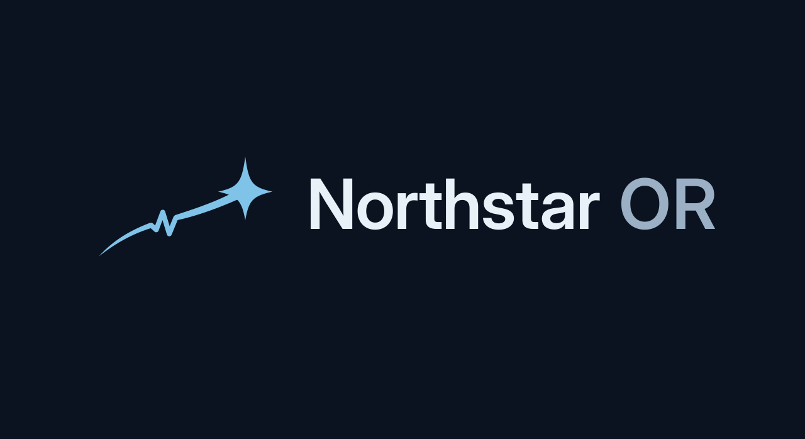

# Northstar OR identity

Northstar OR should feel precise, calm, and credible in an institutional medical setting. The primary identity is a connected shooting North Star with one pulse in its tapered trail, paired with a neutral Inter Display wordmark. One cool blue accent gives it recognition; the OR suffix uses muted ink.

The symbol is the same at every size. The rural clinic and evergreen scene is preserved as presentation illustration in `archive/shooting-star-scene-v1/`; the app uses the simpler star/pulse signature.



## Ready-to-use artwork

| File | Use |
| --- | --- |
| `mark-color-dark.svg` / `.png` | Transparent ice-blue symbol on navy |
| `lockup-horizontal-dark.svg` / `@2x.png` | Primary horizontal identity |
| `lockup-stacked-dark.svg` | Vertical identity |
| `mark-navy.svg` / `.png`, `lockup-horizontal-light.svg` / `@2x.png`, `lockup-stacked-light.svg` | Navy identity for white and light surfaces |
| `mark-white.svg` / `.png`, `lockup-horizontal-white.svg` | Single-color white identity |
| `mark-compact*.svg` | Compatibility filenames for the same symbol |
| `NorthstarOR-AppIcon-1024.svg` / `.png` | Production app icon: square, opaque, 1024 × 1024 |
| `NorthstarOR-final.svg` / `.png` | Presentation artwork with a navy background |
| `NorthstarOR-logo-board.svg` / `.png` | Color, single-color, and small-size proofs |

SVGs are editable masters. Wordmark lettering is outlined, so no font installation is needed.

## Usage

- Use the symbol at least 28 px high, and the horizontal signature at least 280 px wide.
- Keep at least half the star's width as clear space around the symbol. Keep half the wordmark's capital height around a signature.
- Preserve the star/trail connection, proportions, and word spacing. Use the supplied navy artwork on light backgrounds.
- Keep the app icon square and opaque; iPadOS applies its corner mask. The proof board includes 58 px and 40 px app-icon examples.
- Use quiet surfaces, neutral type, and flat controls in the product. Reserve green, amber, and red for actions and meaningful status, paired with labels and icons.

| Identity role | Color |
| --- | --- |
| Midnight navy | `#0B1220` |
| Main wordmark | `#E8F1F8` |
| OR suffix | `#9BB0C4` |
| Connected star/pulse | `#7FC4E8` |

## App integration and export

`AppIcon.appiconset` uses the opaque icon. `BrandMark.imageset` uses the same symbol at 3× for the existing 28 pt header. Shared typography and control styling are maintained in `DesignSystem/NorthstarTheme.swift` in a separate small PR.

On macOS, with Swift command-line tools and Pillow installed:

```sh
python3 docs/brand/source/build_brand.py
```

`source/build_brand.py` holds the shared geometry and layout. `source/wordmark.svg` preserves the outlined Inter Display lettering. `source/render.swift` exports through AppKit. Regeneration writes the SVGs, proof/presentation PNGs, and app assets without network access.

Credits: vector composition and production by OpenAI Codex, informed by the team's North Star and medical-trail direction and earlier OpenAI image-generation exploration. Inter Display uses the SIL Open Font License. AppKit/Swift and Pillow are export tools only. Earlier rural illustrations and Blender studies remain in `archive/`.
